# Global Risk Intelligence Lakehouse

End-to-end **Medallion lakehouse** that ingests WHO Global Health Observatory and World Bank
financial indicators, models them as a star schema, scores every country's health + financial
risk, and serves the result from Snowflake.

**Stack:** Databricks · PySpark · Delta Lake · AWS S3 · Snowflake · dbt · Airflow · Great Expectations · Docker · GitHub Actions

```mermaid
flowchart LR
  A[WHO GHO API<br/>World Bank API] -->|JSON lines + manifest| L[(S3 landing)]
  L -->|Airflow Dataset event| B[Bronze<br/>Delta, raw + lineage]
  B -->|MERGE upserts| S[Silver<br/>typed, deduped]
  S --> G[Gold<br/>star schema + risk score]
  G --> Q{{Great Expectations<br/>quality gate}}
  Q -->|Parquet + COPY INTO| R[(Snowflake RAW)]
  R --> D[dbt staging]
  D --> SN[dbt snapshot<br/>SCD Type 2]
  SN --> M[dbt marts<br/>dims + facts + tests]
```



## What maps to what

| Capability | Where |
|---|---|
| Bronze → Silver → Gold Medallion in PySpark / Delta on S3 | `src/gril/bronze`, `silver`, `gold` |
| ACID `MERGE` upserts with change detection (row hash) | `src/gril/utils/delta_merge.py` |
| Star schema (`dim_country`, `dim_indicator`, `dim_year`, 2 facts) | `src/gril/gold/build_gold.py`, `dbt/models/marts` |
| Risk model (percentile-ranked indicators → health / financial / composite 0–100, tiers) | `compute_risk_scores` in `build_gold.py` |
| Snowflake warehouse load (S3 stage, `COPY INTO`) | `src/gril/warehouse`, `sql/snowflake` |
| **SCD Type 2 in dbt** (+ point-in-time fact joins) | `dbt/snapshots/snap_dim_country.sql`, `dbt/models/marts/dim_country.sql` |
| Data quality gates | `dbt/models/schema.yml`, `dbt/tests/*`, `src/gril/quality/ge_checks.py` |
| Event-driven Airflow DAGs | `airflow/dags/gril_pipeline_dag.py` |
| CI/CD | `.github/workflows/ci.yml`, `databricks.yml` |
| Containers | `Dockerfile`, `docker-compose.yml` |

## Quick start (local, no cloud needed for Bronze → Gold)

```bash
python -m venv .venv && source .venv/bin/activate     # needs Java 17 for Spark
make install
make pipeline          # ingest -> bronze -> silver -> gold -> Great Expectations (data lands in ./data)
make test
```

Data layout under `GRIL_STORAGE_ROOT` (default `./data`; use `s3://bucket/prefix` for AWS):
`landing/` → `bronze/` → `silver/` → `gold/` → `gold_export/` (Parquet for Snowflake).

## Snowflake + dbt

1. Fill in and run `sql/snowflake/01_setup.sql` (database, schemas, warehouse, role, S3 storage integration, stage), then `02_raw_tables.sql`.
2. Set `GRIL_STORAGE_ROOT=s3://<bucket>/<prefix>`, AWS creds and `SNOWFLAKE_*` env vars (see `.env.example`).
3. `make snowflake` (Delta gold → Parquet → `COPY INTO RAW.*`), then `make dbt-build`.

**How SCD2 works here:** each run, `snap_dim_country` compares the freshly loaded country attributes
(name, region, income level, lending type, capital) with the last snapshot. When the World Bank
reclassifies a country (e.g. *Lower middle income* → *Upper middle income*), the old row is closed
(`valid_to`) and a new current row opens. `fact_*` models are incremental `MERGE`s that bind each fact row
to the dimension version valid when it was first loaded, and only refresh measures afterwards.
Singular tests assert windows never overlap and each country has exactly one current row.

## Airflow (Docker)

```bash
cp .env.example .env     # set GRIL_ENABLE_SNOWFLAKE=true once Snowflake is configured
make up                  # UI at http://localhost:8080  (admin / admin)
```

* `gril_ingestion` (daily 02:00) writes the landing files and **publishes the manifest Dataset**.
* `gril_lakehouse_pipeline` is **triggered by that Dataset** (no cron guesswork):
  bronze → silver → gold → GE gate → Snowflake load → dbt deps/snapshot/run/test.
* Set `GRIL_EXECUTION_MODE=databricks` to run the Spark steps as Databricks wheel tasks instead.

## Databricks

`make wheel` builds `dist/gril-*.whl`; `databricks bundle deploy -t dev` deploys the job in `databricks.yml`
(5 wheel tasks sharing one job cluster). Set `GRIL_STORAGE_ROOT` and Snowflake secrets in the cluster env / a secret scope.

## CI/CD (GitHub Actions)

On every PR: ruff, pytest (real local Spark + Delta), `dbt parse` (compiles models/snapshots/tests without a warehouse),
Docker build. On `main`: deploys the Databricks bundle when `DATABRICKS_HOST` / `DATABRICKS_TOKEN` secrets exist.

## Notes / things to verify before production

* WHO indicator codes live in `src/gril/pipeline.yaml`; confirm/adjust them against the GHO API catalogue
  (`https://ghoapi.azureedge.net/api/Indicator`). The risk model is config-driven: add an indicator + direction and it flows through.
* The composite score is a transparent, percentile-based heuristic, not a calibrated forecast.
* Great Expectations is pinned to 0.18 (legacy pandas API). Silver/Gold upserts do not delete rows removed upstream.
